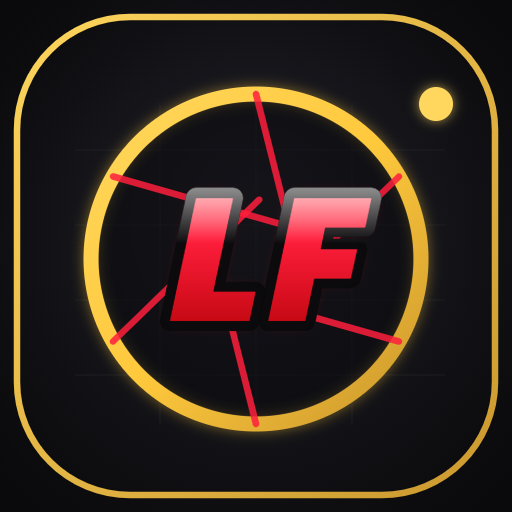

<p align="center">
  
</p>

# 📷 LensForge

<p align="center">
  
  
  
  
  
</p>

**LensForge** is an offline photo studio with pro-grade filter presets, a **PIN-locked private vault**, and **metadata-clean exports**. Everything other apps paywall — presets, watermark-free exports, hidden albums, EXIF stripping — is free here. No account, no cloud, no subscription.

**🔗 Web app: [arj-codex.github.io/lensforge](https://arj-codex.github.io/lensforge)**

## Why LensForge?

Your photos are **leaking**: EXIF GPS tags betray where you live, editors stamp watermarks on *your* pictures, filter packs sit behind subscriptions, and private albums need a paid "pro" tier. LensForge fixes all of it, offline:

- 🎨 **16 pro presets** — Cinema, Noir, Moody, Retro 70s, Neon Night… every pack free, forever
- 🎚 **Fine tune** — brightness, contrast, saturation, warmth, fade, vignette, film grain
- 🧲 **Frame tools** — 90° rotations, flips, aspect crops (1:1, 4:5, 16:9)
- ⬇ **Watermark-free exports** — JPEG/PNG with a quality slider. It's *your* photo.
- 🛡 **Metadata inspector** — see the GPS coordinates and device model a photo secretly carries
- 🧹 **Always-clean exports** — every export is re-encoded, stripping GPS & device metadata automatically
- 🔐 **Private vault** — PIN-gated album (salted-hash PIN, PBKDF2) inside the app's sandbox

## ✨ Features

- 🎛 **Studio** — open any photo, preview presets as live thumbnails of *your* image
- 👁 **Hold-to-compare** — press the button to flash the untouched original
- 🔐 **Vault** — multi-photo import, full-screen viewer, export copies back out
- ⏱ **Auto-lock** — the vault re-locks itself after inactivity (configurable)
- 📱 **PWA** — install to home screen, works fully offline
- 🌗 Dark (default) & light themes · ⌨️ `1`–`3` to switch views
- 🧩 **Zero dependencies** — pure HTML/CSS/JS, no frameworks, no trackers, no network calls

## 🚀 Getting Started

No build step, no dependencies:

```bash
git clone https://github.com/ARJ-CODEX/lensforge.git
cd lensforge
# open index.html in your browser, or serve it:
npx serve .
```

## 🤖 Android

**Direct APK — no Play Store, no account:**

1. Grab **`LensForge-android.apk`** from [**Releases**](https://github.com/ARJ-CODEX/lensforge/releases).
2. Open it on your phone → allow "install unknown apps" for your browser when asked.
3. The gold LF aperture lands on your home screen. 100% offline, zero permissions.

**Or install as a PWA** (no APK): open [the web app](https://arj-codex.github.io/lensforge) in Chrome → **Add to Home screen**.

The APK is built entirely in the cloud (GitHub Actions + Capacitor) — push a `v*` tag and the APK attaches to the release automatically.

## ⌨️ Keyboard Shortcuts

| Key | Action |
| --- | --- |
| `1` | Studio |
| `2` | Vault |
| `3` | Privacy inspector |

## 🛡 Honest Privacy Notes

- The vault lives in the app's **private sandbox storage** (IndexedDB). On Android, app storage is sandboxed per-app; the PIN gates access inside the app. It protects against casual access and shoulder-surfing — it is not encryption-at-rest (planned upgrade).
- Exports are re-encoded, so **metadata is stripped** — but file size/dimensions may differ slightly from the original.
- JPEGs carry EXIF; PNG/WebP inputs never have GPS to begin with.

## 🛠 Tech Stack

- **HTML5** + **CSS3** + **vanilla JavaScript (ES6+)**
- Canvas 2D rendering pipeline (`ctx.filter` + composite overlays) — no WebGL, no libraries
- WebCrypto (PBKDF2-SHA-256) for the vault PIN
- IndexedDB for the vault storage

## 📂 Project Structure

```
lensforge/
├── index.html      # Markup
├── style.css       # ARJ Forge identity (black · red · gold)
├── app.js          # Filter engine, presets, vault, EXIF parser
├── manifest.json   # PWA manifest (Add to Home Screen)
├── sw.js           # Service worker (offline)
├── icon.png        # Brand icon (web favicon + Android launcher)
└── mobile/         # Capacitor config → cloud-built Android APK
```

## 🗺 Roadmap

- 🔐 True encryption-at-rest for vault photos (AES-GCM)
- 🖼 Full device-gallery browser (MediaStore integration)
- ✂️ Free-form crop handles + straighten slider
- 📤 Share sheet integration on Android

## ™ Trademark & Branding

**LensForge™** and its logo are the exclusive brand of **ARJ-CODEX**.

You may use the LensForge name only to refer to this original project. You may **not**:

- Rebrand or redistribute this project under any other name
- Use the LensForge name or logo for your own products, domains, or marketing
- Present a modified version as an official LensForge release

Personal and internal use is free, and contributions to this repository are welcome — see the [License](LICENSE) for full terms.

## 📄 License

Released under the **[LensForge Brand License (FBL)](LICENSE)** — free to use, protected against rebranding.
